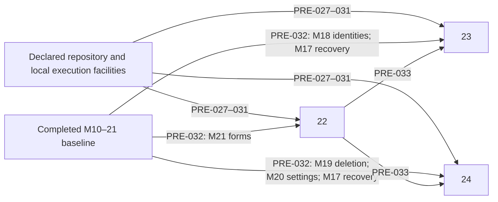
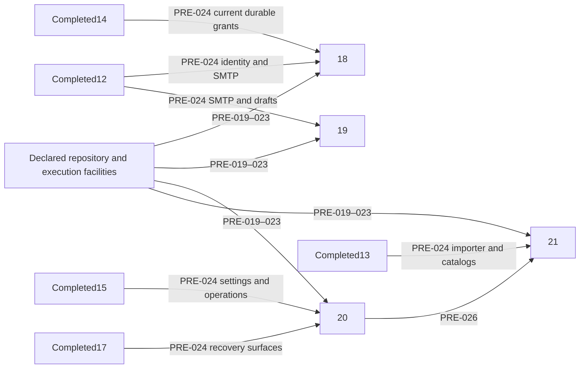
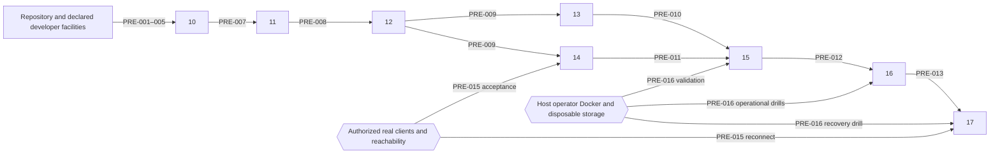

# Milestone prerequisite manifest — UX6 refinements

- Packet: `delivery/milestones/secretsauce-mcp/status.yaml`
- Product ID: `secretsauce-mcp`
- Audited revision: exact post-readiness hashes in `workflow/delivery-planning/results/readiness.yaml`.
- Source transaction: `69611ec52040a3619e0e503b0abdc223e995f4a1`.
- Planning transaction: parent-owned, pending closeout; start `346ce2feaf2014052ced6eba1c52ce56150aa887`.
- Intended order: M37 → M38 → M39 → M40; all independent of one another, dependent only on completed providers.
- Order evidence: status dependencies and index; all 31 records traversed.
- Last audit: 2026-10-18.

| ID | Description | Consumers | Classification | Current status | Proposed provider | Class | Verification | Commands executed | Files changed | Blocking | Evidence |
| --- | --- | --- | --- | --- | --- | --- | --- | --- | --- | --- | --- |
| PRE-051 | Current committed UX6 authority and planning publication | M37–40 | Already satisfied | 17 authority hashes, source hash and ancestry verified; final planning publication remains parent-owned | Definition producer / parent planning | AUTO | Verify final handoff and hashes before delivery | Python hash/ancestry PASS | None | Before delivery handoff | FACT: definition package and compiler source provenance |
| PRE-052 | Locked runtime/build dependencies and certificate tooling | M37–40 | Already satisfied | Node26.11.1/npm12.2.0/OpenSSL3.6.5; packages complete; setup unchanged | package.json/lockfile, CI Node22, Dockerfile | AUTO | Documented clean checkout npm ci/build; local npm ls and versions | Versions/npm ls PASS; setup diff empty | None | Before validation | FACT: package manifests; CI; Dockerfile; prior readiness |
| PRE-053 | Disposable HTTPS, headless screenshot/keyboard and temporary state facilities | M37–40 | Already satisfied | Matching Chromium executable present; unchanged M36 browser source/evidence and prior HTTPS probe remain valid | Declared Playwright and local authorized runner | AUTO | Documented browser install; fixture isolation; hash-verify current browser evidence | Browser executable check PASS; M36 hashes PASS | None | Before browser acceptance | FACT: docs/console-operations.md; M36 validation.json and browser-report.json |
| PRE-054 | Completed review/approval and focused editor/navigation/rule foundations | M37–40 | Already satisfied | M35/36 for37, M36 for38, M27/33 for39, M31 for40 are completed; contracts and records unchanged | Completed repository milestones | AUTO | Graph and status/evidence inspection | Python31-record graph/preservation PASS | None | Before implementation | FACT: status.yaml; provider acceptance paths |
| PRE-055 | Feature-specific positive/negative/boundary and visual acceptance | M37–40 | Owned by the consuming milestone | Existing fixture extension points available; new feature evidence pending delivery | Each consuming milestone | AUTO | Focused tests; actual matching-reference screenshots; bounded full suite/build | Not run: implementation-owned acceptance | New milestone readiness sections only | Before acceptance | FACT: each Required Validation; UX6 visual delta precedence |

## Dependency graph and clean setup

Repository facilities PRE-051–053 feed all four consumers. PRE-054 edges: completed M35/M36 → M37; completed M36 → M38; completed M27/M33 → M39; completed M31 → M40. PRE-055 is consuming-milestone work, not a startup dependency. There is no missing, external or unresolved provider and no cycle. Numeric order is one valid deterministic execution order, not evidence of dependency.

Conceptual clean checkout: provision documented Node >=22/npm/OpenSSL, writable temporary storage and authorized loopback; `npm ci`, `npm run build`, then `PLAYWRIGHT_BROWSERS_PATH=/tmp/secretsauce-feedback-browsers npx playwright install chromium`. Cache is disposable, not a required prior output. Downloads need network permission; OS installation on another host is operator-owned. No secret, database, real identity provider or live review instance is needed. M36's current 13 frozen input hashes and successful 772-test/build/browser evidence were checked; setup matches the prior verified readiness transaction. No new browser probe or full suite was needed to establish unchanged facilities. This does not accept the four future features.

Full-suite acceptance runs `npm test -- --maxWorkers=2` alone, with source frozen and no browser/Docker load. No Docker recovery drill is added for presentation-only changes; changing a recovery/transport boundary triggers its existing gates. Real ChatGPT/Codex verification remains NOT RUN under `workflow/delivery/local-validation-authorization.md`; no new waiver or interoperability claim.

## Historical readiness

Unchanged prior manifest follows; PRE-001–050 describe historical packets only.

# Milestone prerequisite manifest — approved feedback 004

- Packet: `delivery/milestones/secretsauce-mcp/status.yaml`
- Product ID: `secretsauce-mcp`
- Audited revision: exact final packet hashes in `workflow/delivery-planning/results/readiness.yaml`.
- Source transaction: `d84ac2265bd6c055a6da5edfe5f3d586137d30e9`.
- Planning transaction: parent-owned, pending finalization; start `c83135ab09113dde5ffd39b134a0ef3e9dec5fc4`.
- Intended order: M35 → M36; completed M10–34 retained.
- Order evidence: manifest explicit dependencies and index; entire 27-record graph verified.
- Last audit: 2026-10-18.

| ID | Description | Consumers | Classification | Current status | Proposed provider | Class | Verification | Commands executed | Files changed | Blocking | Evidence |
| --- | --- | --- | --- | --- | --- | --- | --- | --- | --- | --- | --- |
| PRE-045 | Approved current UX5 definition and packet publication | M35–36 | Already satisfied | 17 authority hashes and producer ancestry verified; final planning closeout parent-owned | Definition producer / parent planning | AUTO | Hash package sources; verify producer ancestry and final handoff | Python hash/history PASS | None | Before delivery handoff | FACT: definition-package.yaml; compiler.yaml; UX-DESIGN-005 |
| PRE-046 | Locked runtime/build dependencies and HTTPS certificate tooling | M35–36 | Already satisfied | Node26.11.1/npm12.2.0/OpenSSL3.6.5; complete packages; setup unchanged since prior verified install | package.json/lockfile, CI Node22, Dockerfile | AUTO | Fresh checkout npm ci/build; current versions/npm ls | Versions and npm ls PASS; setup diff empty | None | Before validation | FACT: package.json; .github/workflows/ci.yml; prior readiness |
| PRE-047 | Disposable HTTPS, headless screenshot and keyboard facility | M35–36 | Already satisfied | Actual HTTPS/Chromium156.0.8078.4 focus/screenshot PASS | Authorized local runner, declared Playwright, documented install | AUTO | Synthetic temporary certificate/server; browser navigation/focus/screenshot | Default EPERM; identical permitted probe PASS | None | Before browser acceptance | FACT: docs/console-operations.md:23; navigation browser harness; current probe |
| PRE-048 | Completed editing, navigation, destination and server review foundations | M35–36 | Already satisfied | M27/M28/M33 and transitive M10–34 complete; unchanged contracts/status | Completed repository providers | AUTO | Graph and completed record/hash comparison | Python preservation/graph PASS | None | Before implementation | FACT: packet status; test/console-services.test.ts; navigation/destination harnesses |
| PRE-049 | Grouped review and complete proposal | M36 | Provided by an earlier milestone | M35 ordered first; acceptance required before M36 begins | M35 | AUTO | Confirm completed M35 with current evidence/commit | Not run: future feature delivery | None | Before M36 | FACT: M36 dependency M35; M35 outcome contract |
| PRE-050 | Comparison/dialog/exception positive-negative-boundary and visual evidence | M35–36 | Owned by the consuming milestone | Existing synthetic harness extension points; feature checks remain delivery-owned | Each consuming milestone | AUTO | Targeted new tests; actual approved-reference screenshots; full suite2workers/build; M36 joined flow | Not run: feature acceptance | New milestone readiness sections only | Before acceptance | FACT: M35/M36 Required Validation; AGENTS.md |

## Dependency graph and clean setup

Repository facilities PRE-045–047 → both milestones. Completed M27/M33 → M35 and completed M28 → M36 (PRE-048). M35 → M36 (PRE-049). PRE-050 is owned by each consumer and creates no startup cycle. No missing, external or unresolved provider is introduced.

A clean checkout supplies documented Node >=22/npm/OpenSSL, writable temporary storage and permitted loopback; runs `npm ci` and `npm run build`; installs matching Chromium with `PLAYWRIGHT_BROWSERS_PATH=/tmp/secretsauce-feedback-browsers npx playwright install chromium`. Download access may require network permission; OS provisioning on another host remains operator-owned. No real secrets, database, identity provider or live instance is needed. Actual product screenshot comparisons remain required; the facility probe is not feature acceptance. Full suite uses `npm test -- --maxWorkers=2` without concurrent browser/Docker work. Presentation-only scope adds no Docker recovery gate; an actual boundary change requires its affected existing checks.

Existing real ChatGPT/Codex verification exception remains NOT RUN under `workflow/delivery/local-validation-authorization.md`; local protocol tests remain required. No new external dependency or interoperability claim.

## Historical readiness

The unchanged prior content below retains PRE-001–044 links and evidence. Its statuses govern historical packets only, not M35–36.

# Milestone prerequisite manifest — approved feedback 003

- Packet: `delivery/milestones/secretsauce-mcp/status.yaml`
- Product ID: `secretsauce-mcp`
- Audited revision: exact post-readiness packet pinned in `workflow/delivery-planning/results/readiness.yaml`.
- Source transaction: `d0dffc6ffbc47f114dc232abedf40f50db3e52f3`
- Planning transaction: parent-owned, pending finalization in `workflow/delivery-planning/handoff.yaml`; start `e975b171fac96167f0909cf588b5022842a6950b`.
- Intended order: M25 → M26 → M27 → M28 → M29 → M30 → M31 → M32 → M33 → M34.
- Order evidence: manifest explicit dependencies and index; numeric order is a valid selected topological order, not dependency evidence.
- Last audit: 2026-10-18.

## Active feedback 003 prerequisites

| ID | Description | Consumers | Classification | Current status | Proposed provider | Class | Verification | Commands executed | Files changed | Blocking | Evidence |
| --- | --- | --- | --- | --- | --- | --- | --- | --- | --- | --- | --- |
| PRE-035 | Committed definition, approved UX4/reference assets and current packet | M25–34 | Already satisfied | 96 source/reference digests and upstream producers verified; parent publication pending | Definition producer and parent planning transaction | AUTO | Hash approved artifacts; check upstream commit ancestry | Python hash/history PASS | None | Before delivery handoff | FACT: workflow/definition/definition-package.yaml; product/ux/manifest.yaml |
| PRE-036 | Declared Node/npm dependencies, compiler and HTTPS certificate tooling | M25–34 | Already satisfied | Node26.11.1/npm12.2.0/OpenSSL3.6.5; packages complete; setup unchanged since isolated install | package.json/lockfile, CI Node22, Dockerfile | AUTO | Fresh checkout npm ci; npm run build; inspect versions | Version/npm ls PASS; setup diff empty | None | Before build/validation | FACT: package.json; package-lock.json; .github/workflows/ci.yml; prior feedback001 isolated install |
| PRE-037 | Matching Chromium, keyboard, screenshot and visual reference facility | M25–34 | Already satisfied | Chromium156.0.8078.4 headless launch/focus/screenshot PASS | Declared Playwright and documented Chromium install | AUTO | Install matching Chromium; run actual browser and compare matching states during acceptance | Permitted static browser probe PASS | None | Before browser acceptance | FACT: docs/console-operations.md:23; approved UX manifest; scripts/verify-console-friendly-import-browser.mjs |
| PRE-038 | Disposable writable state and local HTTP/HTTPS fixtures | M25–34 | Already satisfied | Ephemeral loopback request and temporary screenshot succeeded | Authorized local runner; synthetic fixtures | AUTO | Listen/fetch/close; inspect synthetic isolated fixture setup | Default EPERM; identical permitted probe PASS | None | Before integration acceptance | FACT: AGENTS.md; test/setupAudit.ts; scripts/verify-console-friendly-import-browser.mjs |
| PRE-039 | Docker, managed launcher/leases and isolated recovery facilities | M29, M34; other affected container regressions | Already satisfied | Docker client/server29.9.0; Compose5.6.0; launcher and recovery harness available | Local Docker; Dockerfile; existing recovery scripts | AUTO | Read-only docker version/compose; build current test image for actual acceptance | Default socket denied; permitted docker version PASS | None | Before required operational validation | FACT: scripts/docker-launcher.mjs; scripts/verify-console-recovery-{crashes,launcher,cleanhost}-docker.mjs |
| PRE-040 | Completed managed state, import, identity, service/policy, audit and recovery foundations | M25–34 | Already satisfied | M10–24 completed providers retained; tests/harnesses exist | Existing completed repository milestones | AUTO | Inspect manifest and acceptance; no reacceptance of unchanged history | Inspected status and source/fixture facilities | None | Before dependent implementation | FACT: status.yaml M10–24; test/console-{services,migration,backups,recovery}.test.ts |
| PRE-041 | Focused same-draft sections and applicable rule editor | M28, M30–33 | Provided by an earlier milestone | M27 supplies focused sections; M31 supplies M33 rule editor | M27; M31 for M33 | AUTO | Require named provider completed with current committed acceptance | Not run: future feature delivery | None | Before dependent milestone start | FACT: status.yaml dependencies; M27/M31 contracts |
| PRE-042 | Durable clear, absence/generation and successful actor metadata | M30, M34 | Provided by an earlier milestone | M29 precedes both consumers | M29 | AUTO | M29 completed with actual dispatch/restart and format compatibility evidence | Not run: future feature delivery | None | Before dependent milestone start | FACT: M29 functional requirements; M30/M34 dependencies |
| PRE-043 | All new service outcomes for final integrated acceptance | M34 | Provided by an earlier milestone | Compiler correction makes all M25–33 providers explicit directly or transitively | M25–33 | AUTO | Traverse corrected dependencies and verify earlier completion before M34 | Post-correction graph audit | M34/index/status/compiler dependency correction by compiler | Before M34 final integrated acceptance | FACT: M34 Required Validation; corrected status dependencies |
| PRE-044 | New input, fault/race, compatibility, browser and recovery acceptance fixtures | M25–34 | Owned by the consuming milestone | Existing harnesses provide extension points; new behavior evidence not yet produced | Each consuming milestone | AUTO | Positive/negative and boundary fixtures; actual matching-reference visual comparisons; full npm test/build at completion | Not run: implementation-owned acceptance | None | Before each milestone acceptance | FACT: Each Required Validation; STATE-09; SECRES-T17–T21; UX-V05/C42/C53 |

## Feedback 003 dependency graph

Provider edges use PRE-040 for completed foundations, PRE-041 for focused/rule editing, PRE-042 for durable credential mutation, and PRE-043 for final integration. PRE-035–039 provide the common repository/local facilities to all applicable consumers; PRE-044 belongs inside each milestone and is not a startup cycle. The exact corrected adjacency graph is in the current readiness report. No external/unresolved node remains for this local delta.

## Setup and evidence boundary

A clean checkout needs Node >=22 (CI/container use22), npm, OpenSSL, permitted loopback, writable temporary storage and Docker for operational checks. Run `npm ci` and `npm run build`. Use `PLAYWRIGHT_BROWSERS_PATH=/tmp/secretsauce-feedback-browsers npx playwright install chromium` and the same variable for browser runs. Downloads require network permission; OS provisioning on another host is operator-owned. The temporary cache is disposable, never an undeclared prerequisite.

Existing browser fixtures create synthetic HTTPS/identity/audit state and clean their own temporary directories. Actual product screenshots must match approved state/viewport/reference hashes and be examined for width, spacing, density, typography, controls, colors and hierarchy; a static facility probe is not visual acceptance. Include keyboard, narrow-width and 200%-text/document/text-range overflow checks. Keep evidence in new milestone-specific paths, preserving historical evidence.

Docker acceptance must build the current source image and record its immutable ID, using isolated synthetic app/audit/backup/restore mounts and the managed launcher/kernel leases. Existing configurable harnesses accept M15_DOCKER_IMAGE/M16_DOCKER_IMAGE/M17_DOCKER_IMAGE/M23_DOCKER_IMAGE/M24_DOCKER_IMAGE. The legacy launcher harness fixes `secretsauce-m17-local:acceptance`; consuming-milestone fixture adaptation must avoid trusting stale tags or overwriting historical evidence. Prior-reader tests must separately pin the actual prior reader, not mistake new helpers/import failures for format rejection. No running review instance or its mounts are a test prerequisite.

Historical real ChatGPT/Codex connection evidence remains NOT RUN under `workflow/delivery/local-validation-authorization.md`; no new external-client gate is added. Local protocol/authorization checks stay mandatory, and real interoperability/release claims require `docs/m14-real-client-verification.md`.

## Historical readiness

Exact previous active artifacts are preserved as `prerequisite-manifest-feedback-002.md` and `readiness-report-feedback-002.md`. The original content below remains for historical links only; its statuses do not govern M25–34.

# Milestone prerequisite manifest — approved feedback 002

- Packet: `delivery/milestones/secretsauce-mcp/status.yaml`
- Product ID: `secretsauce-mcp`
- Audited revision: compiler packet `sha256:e3e889fa5d548d6bcb46a27aa12bd894b495d8ca69ca81217c22f1d7ddc0b00c`; post-readiness packet pinned in `workflow/delivery-planning/results/readiness.yaml`.
- Source transaction: `653ac14f771dc1da7d1d650c577ff439e9b99bce`
- Planning transaction: parent-owned, pending finalization in `workflow/delivery-planning/handoff.yaml`; start `b2b66608908ca1e2dc9f61ce66856780ccf68b8e`.
- Intended pending order: M22, M23, M24. M22 supplies both later milestones; M23 and M24 are independent of each other.
- Order evidence: packet `status.yaml` dependencies and `index.md#milestones-and-dependencies`.
- Last audit: 2026-10-12.

## Active feedback 002 prerequisites

These rows govern M22–24. Historical PRE-001–026 below retain their original evidence and then-current statuses; they do not reopen completed milestones or establish current readiness. No real SMTP account, deployment secret, external identity provider or live user instance is needed.

| ID | Description | Consumers | Classification | Current status | Proposed provider | Class | Verification | Commands executed | Files changed | Blocking | Evidence |
| --- | --- | --- | --- | --- | --- | --- | --- | --- | --- | --- | --- |
| PRE-027 | Committed approved definition, UX3 references and current packet | M22–24 | Already satisfied | All source/reference digests and upstream commits verified; parent planning closeout pending | Repository definition and parent transaction | AUTO | Inspect committed parent handoff and pinned sources before delivery | Hash/history check PASS | None | Yes before delivery handoff | FACT: workflow/definition/definition-package.yaml; status.yaml compiled_from; product/ux/manifest.yaml |
| PRE-028 | Locked Node/npm packages and HTTPS fixture tooling | M22–24 | Already satisfied | Node26.11.1, npm12.2.0, OpenSSL3.6.5; npm ls complete; lock/package/CI/Docker unchanged since prior verified isolated install/build | package.json, lockfile, CI Node22 and Dockerfile | AUTO | Fresh checkout npm ci; npm run build; node/npm/openssl versions | Versions/npm ls PASS; setup-file diff empty | None | Yes before build/validation | FACT: package.json; package-lock.json; .github/workflows/ci.yml; prior readiness report isolated install |
| PRE-029 | Declared Chromium and real rendered screenshot/keyboard facility | M22–24 | Already satisfied | Playwright1.64.0 Chromium156.0.8078.4 launch, focus and screenshot PASS | Declared package and documented browser download | AUTO | Install matching Chromium, use same PLAYWRIGHT_BROWSERS_PATH for harness | Default sandbox SIGTRAP/EPERM; identical permitted static probe PASS | None | Yes before visual acceptance | FACT: docs/console-operations.md; scripts/verify-console-friendly-forms-browser.mjs; current static probe |
| PRE-030 | Disposable storage and permitted local HTTP/HTTPS/SMTP listeners | M22–24 | Already satisfied | Ephemeral loopback request PASS; writable temporary screenshot; OpenSSL available | Authorized local runner and synthetic repository fixtures | AUTO | Ephemeral local listener/request/close; inspect synthetic temp paths | Permitted loopback PASS | None | Yes before local validation | FACT: test/console-notifications.test.ts actual TLS fixture; test/setupAudit.ts; scripts/verify-console-browser.mjs |
| PRE-031 | Docker/Compose, lease launcher and isolated recovery mounts | M23–24; M22 if affected container regression | Already satisfied | Client/server29.9.0 and Compose5.6.0 verified; no container started or user state inspected | Local Docker and existing launcher/drill scripts | AUTO | docker version; docker compose version; inspect isolation before required drills | Default socket denied; permitted read-only version PASS | None | Yes before required container validation | FACT: Dockerfile; deploy/compose.yaml; scripts/verify-console-recovery-launcher-docker.mjs; scripts/verify-console-backups-docker.mjs |
| PRE-032 | Completed console, identity/revocation, SMTP deletion, Settings and recovery baseline | M22–24 | Already satisfied | M10–21 completed records and committed evidence preserved | Existing M10–21 repository | AUTO | Inspect completed provider records, evidence and relevant harnesses | Complete packet and provider facilities inspected | None | Yes before dependent implementation | FACT: status.yaml M10–21; evidence/qa/secretsauce-mcp/milestone21/acceptance.md; milestone18/acceptance.md; milestone19/acceptance.md; milestone20/acceptance.md |
| PRE-033 | Shared readable forms/layout/copy delivered by M22 | M23–24 | Provided by an earlier milestone | Pending M22 implementation; explicitly ordered before both consumers | M22 | AUTO | M22 completed with committed functional and matching-reference visual evidence | Not run: future feature delivery | None | Yes before M23/M24 start | FACT: status.yaml dependencies; M22 Scope; M23/M24 Preconditions |
| PRE-034 | Feature-specific tests, migrations, fault/restart/archive fixtures and screenshot comparison evidence | M22–24 | Owned by the consuming milestone | Existing harnesses support extension; new behavior and acceptance evidence are owned by each outcome | Each consuming milestone | AUTO | Slice plans name exact isolated fixtures and commands; compare actual screenshots to approved references at matching states/viewports under UX-V05/C42 | Not run: future feature acceptance | None | Yes before owning milestone acceptance | FACT: M22–24 Required Validation and UX Constraints; scripts/verify-console-*-browser.mjs; test/console-notifications.test.ts; recovery Docker fixtures |

## Feedback 002 dependency graph

PRE-034 belongs inside each milestone; it is not a dependency cycle. All completed providers' transitive predecessors exist. Shared console files favor serial M22 → M23 → M24 execution and regression testing, without inventing an M23 → M24 dependency. No new external or unresolved node is required. Historical actual ChatGPT/Codex evidence remains NOT RUN under `workflow/delivery/local-validation-authorization.md`; these new milestones require no new real-client connection. A release/interoperability claim still needs `docs/m14-real-client-verification.md`.

## Setup and visual evidence boundary

On a fresh checkout provide declared Node (CI/Docker use22), npm, OpenSSL, writable temp storage and loopback execution; run `npm ci` and `npm run build`. Provision Chromium with `PLAYWRIGHT_BROWSERS_PATH=/tmp/secretsauce-feedback-browsers npx playwright install chromium`, then retain that same environment variable for browser commands. Downloads may require network permission. This cache is disposable: a successful current launch does not make it a hidden clean-checkout dependency. Do not install OS packages or change host security implicitly.

Browser harnesses use actual HTTPS, synthetic state/identities and isolated temp directories. Extend them for exact 1440px/390px mockup states plus mandatory 320px/enlarged-text checks. Approved references and their hashes are available in `product/ux/manifest.yaml`; all were verified in this audit. Each milestone must record actual images, reference hash/path, role/state/viewport and differences/resolution. Functional assertions or a generic browser smoke cannot pass visual acceptance. Output new evidence to milestone-specific paths; do not overwrite historical captures. SMTP TLS and plaintext/auth variants, restore acknowledgment and identity metadata cases are consuming-milestone fixture work, not missing shared infrastructure.

## Historical readiness (unchanged prior content)

The following original material is retained for old milestone links. Exact original copies are also in `prerequisite-manifest-feedback-001.md` and `readiness-report-feedback-001.md`.

# Milestone prerequisite manifest — approved feedback

- Packet: `delivery/milestones/secretsauce-mcp/status.yaml`
- Product ID: `secretsauce-mcp`
- Audited revision: compiler packet `sha256:ef5ac5285860c20f70df161413849909f4ff06f1ca80fa295d8f7fb68e6e6611`; exact post-readiness packet pinned in `workflow/delivery-planning/results/readiness.yaml`.
- Source transaction: `4d46db3fa08a25df52b8d7b0aa2357cf8446b2fd`
- Planning transaction: parent-owned, pending finalization in `workflow/delivery-planning/handoff.yaml`; start `9ff135f3299fa36d773c243b72c0185a5fbd7fb5`.
- Intended pending order: M18, M19, M20, M21; only M20 → M21 is a new dependency.
- Order evidence: packet `status.yaml` dependencies and `index.md#milestones-and-dependencies`.
- Last audit: 2026-10-11.

## Active feedback prerequisites

These rows govern M18–21. The original PRE-001–018 manifest is retained below as historical initial-build evidence, including its then-pending providers and external gates. Its old status is not the current delta status; completed M10–17 records and the explicit local-validation exception remain intact.

| ID | Description | Consumers | Classification | Current status | Proposed provider | Class | Verification | Commands executed | Files changed | Blocking | Evidence |
| --- | --- | --- | --- | --- | --- | --- | --- | --- | --- | --- | --- |
| PRE-019 | Committed current definition, approved UX2, resolved remediation and planned packet | M18–21 | Already satisfied | Compiler verified source hashes/history; final planning commit remains parent closeout | Repository definition package and parent transaction | AUTO | Inspect source hashes and finalized parent handoff before delivery | Compiler result consumed; Git HEAD/status inspection | None | Yes before delivery handoff | FACT: workflow/definition/definition-package.yaml; compiler.yaml eligibility and source |
| PRE-020 | Declared runtime, lockfile dependencies, compiler and HTTPS fixture tools | M18–21 | Already satisfied | Node26.11.1/npm12.2.0/OpenSSL3.6.5; isolated locked install and build pass | package.json, package-lock.json, CI Node22, Dockerfile | AUTO | npm ci; npm run build; node/npm/openssl versions | Isolated npm ci --offline --no-audit --no-fund:215 packages; npm run build PASS | None | Yes before implementation/build | FACT: package.json engines/scripts; .github/workflows/ci.yml; scripts/verify-console-people-browser.mjs |
| PRE-021 | Matching declared Playwright Chromium for actual HTTPS/keyboard/reflow checks | M18–21 | Already satisfied | Missing current browser remediated using documented download to disposable /tmp; headless launch/focus PASS | Locked @playwright/test and documented install | AUTO | Same PLAYWRIGHT_BROWSERS_PATH for install and harness execution; launch current browser | Documented install completed with network permission; synthetic headless page/focus PASS Chromium156.0.8078.4 | None; temporary browser files only | Yes before UI acceptance | FACT: docs/console-operations.md browser procedure; current scripts import declared Playwright |
| PRE-022 | Writable synthetic temp state and loopback/network execution permission | M18–21 | Already satisfied | Disposable checkout/storage and loopback request verified; restricted default fails EPERM | Authorized execution runner and isolated test facilities | AUTO | Ephemeral 127.0.0.1 listener/fetch; permission-preserving rerun on EPERM | Default EPERM; identical permitted probe PASS | None | Yes before local validation | FACT: AGENTS.md; test/setupAudit.ts; existing HTTP/HTTPS fixtures |
| PRE-023 | Docker/Compose and isolated mounts for any affected container regression | M18–21 when container checks are required | Already satisfied | Client/server29.9.0 and Compose5.6.0 available through narrow permission; no container started | Existing local Docker and committed launcher/drill scripts | AUTO | docker version; docker compose version; inspect target isolation before each drill | Socket denied by default; permitted read-only version PASS | None | Conditional before required container validation, not source-work start | FACT: Dockerfile; scripts/docker-launcher.mjs; scripts/verify-console-*-docker.mjs; prior M17 acceptance |
| PRE-024 | Delivered encrypted state, audit, identity/grants, settings/import, operating and recovery infrastructure | M18–21 | Already satisfied | M10–17 completed with committed local acceptance; known real-client NOT RUN preserved | Existing repository M10–17 | AUTO | Inspect completed records and source/harness/acceptance artifacts, retain working behavior | Records, source facilities and M17 cumulative acceptance inspected | None | Yes before dependent work | FACT: status.yaml records; evidence/qa/secretsauce-mcp/milestone17/acceptance.md; src and test console/OAuth modules |
| PRE-025 | Delta-specific fixtures, migrations, failure/race tests and capability/browser coverage | M18–21 | Owned by the consuming milestone | Pending implementation by each outcome; credible reusable local facilities verified | Each consuming milestone | AUTO | Required Validation and slice plan identify test data, safe output and exact executable commands before acceptance | Not run: future feature acceptance; existing harness/test files inspected | None | Yes before owning milestone acceptance | FACT: M18–21 Required Validation; test/console-people*, console-notifications, console-advanced, managed-oauth; scripts/verify-console-* |
| PRE-026 | Focused Settings shell, authorized field navigation and exact settings draft review | M21 | Provided by an earlier milestone | Pending M20, ordered before M21 | M20 | AUTO | M20 completed with current committed acceptance and preserved full-console routes | Not run: future implementation | None | Yes before M21 starts | FACT: status.yaml M21 dependencies; M20 Scope and M21 Preconditions |

No newly required real external account, SMTP provider, production secret, database, hosted endpoint or OS installation. Actual LLM platform connection evidence remains historical NOT RUN; this delta's reset revocation, configuration and import checks use actual local HTTPS plus synthetic OAuth/MCP clients. This does not extend the old waiver to a new release/interoperability claim. Any such claim still needs the existing real-client procedure. No external node consumes a new milestone in the audited graph.

## Active dependency graph

Each milestone owns PRE-025. Completed baseline providers have all transitive dependencies in the preserved manifest. M13 is already completed and is available transitively through M20's M15 dependency. Shared files do not require new feature ordering: M18/19 can deliver in the current shell; M20 must preserve whichever completed actions exist. Sequential M18, M19, M20, M21 minimizes concurrent editing without inventing dependencies.

## Clean-environment setup and verification

From a clean checkout, provide declared Node>=22/npm, OpenSSL, writable temporary storage and permitted loopback execution. `npm ci` uses the lockfile; `npm run build` compiles. Use `PLAYWRIGHT_BROWSERS_PATH=/tmp/secretsauce-feedback-browsers npx playwright install chromium` and pass the same variable to browser commands. Network/browser execution needs normal narrow sandbox permission here. If OS libraries are missing on a different host, that host must supply them; this host's launch succeeded without OS changes. The `/tmp` browser cache is disposable and not an undeclared permanent provider.

All synthetic keys/users/SMTP/downstreams/archives derive from existing fixture code; no running application or real account is assumed. M18 consumes completed identity/grant providers; M19 consumes SMTP/store/review providers; M20 consumes delivered settings/backup/recovery routes; M21 consumes completed M20 plus existing M13. Implementing each new behavior and updating affected fixtures is PRE-025, not missing bootstrap.

Current evidence separates facility checks from feature acceptance. Clean lockfile installation used available npm cache, not a cold registry or CI Node22 run. npm12 blocked esbuild postinstall under its existing allowScripts policy; build nevertheless succeeded, and no policy was weakened. Baseline620-test/67-file evidence is historical M17 acceptance, not a newly executed suite. Run required new/related tests, full suite and browser tasks during delivery. No application test or acceptance is claimed by this document-only readiness transaction.

## Historical initial-build manifest (preserved)

# Milestone Prerequisite Manifest

- Packet: `delivery/milestones/secretsauce-mcp/status.yaml`
- Product ID: `secretsauce-mcp`
- Audited revision: final packet content digest in `workflow/delivery-planning/results/readiness.yaml`; compiler input `sha256:be71b3924591bc444b5da8b31ef0982f9e5e207024683c4c74806d2e13b8fe0d`.
- Source transaction: `06dd0ee59defd1a75db121f1d8133c7100238b80`; definition provenance closeout `bb6f29cd318b77c2cf70efa5b1f9adaf25fdf2cb`.
- Planning transaction: pending parent finalization; canonical commit is `workflow/delivery-planning/handoff.yaml` transaction.repository_commit. No child commit.
- Intended order: `10 → 11 → 12 → {13,14} → 15 → 16 → 17`.
- Order evidence: packet `status.yaml` dependencies and `index.md` Milestones and dependency contracts.
- Last audit: `2026-10-10T02:04:36+00:00`.

Current readiness concerns providers and execution facilities, not implementation completion. All eight milestones remain pending. A future provider is not described as already satisfied. Common developer inputs are explicit: supported Node/npm, locked package retrieval via registry or populated cache, writable working/temp directories, loopback permission and a local browser. No undeclared global frontend/database/service is assumed.

| ID | Description | Consumers | Classification | Current status | Proposed provider | Class | Verification | Commands executed | Files changed | Blocking | Evidence |
| --- | --- | --- | --- | --- | --- | --- | --- | --- | --- | --- | --- |
| PRE-001 | Committed definition, approved UX and unchanged historical gateway authority | 10–17 | Already satisfied | Verified source package/manifest revisions; no product decisions pending | Repository definition package and compiled_from | AUTO | Inspect exact source revisions and producer history; inspect approved UX manifest | Compiler source checks consumed; Git HEAD/status inspected | None | Yes, before starting | FACT: status.yaml compiled_from; workflow/definition/definition-package.yaml |
| PRE-002 | Existing source, fixture catalogs, build/test scripts and CI baseline | 10–17 | Already satisfied | Verified 33 test files / 372 tests and build in isolated install | Repository package.json, lockfile, src, test, .github/workflows/ci.yml | AUTO | npm run build; npm test | Passed; initial sandbox listener failure resolved by unchanged permitted rerun | None | Yes, before validating | FACT: package.json scripts; CI quality-gates; test/gateway.test.ts self-signed fixtures |
| PRE-003 | Node >=22, npm, package retrieval and writable checkout/temp storage | 10–17 | Already satisfied | Host Node26.11.1/npm12.2.0; isolated cached installation verified; CI pins Node22 | Declared developer runtime plus locked npm packages | AUTO | node --version; npm --version; npm ci on clean checkout with registry/cache access | Versions; isolated npm ci --offline --no-audit --no-fund succeeded | None | Yes, before starting | FACT: package.json engines; Dockerfile Node22; CI setup-node22. Cold-network retrieval not exercised |
| PRE-004 | Loopback listener permission and disposable filesystem for tests | 10–17 | Already satisfied | Available through approved narrow network execution; restricted default denies bind | Execution runner / existing synthetic test facilities | AUTO | npm test with loopback permission; no public bind required | Sandbox EPERM; identical npm test with loopback permission passed372 | None | Yes, before validating | FACT: AGENTS.md loopback rule; test/server.test.ts and test/gateway.test.ts |
| PRE-005 | Browser available for rendered, keyboard and narrow-width evidence | 10–17 | Already satisfied | Chrome154 installed; approved concept rendered earlier; no product browser acceptance yet | Developer browser; clean runner must explicitly provide browser | AUTO | Check installed browser version; render implemented local page and verify keyboard/320px when available | /opt/google/chrome/chrome --version; prior UX inspection consumed | None | Yes, before UI validation | FACT: installed Chrome; workflow/definition/drafts/product-ux/web-console-initial/index.md Visual inspection |
| PRE-006 | Reproducible console build/browser harness, durable-store setup and synthetic auth/fault fixtures | 10 | Owned by the consuming milestone | Not implemented; explicit first outcome scope | 10 secure setup vertical outcome | AUTO | Inspect 10 implementation plan for declared dependencies, lockfile, fixture-only storage/keys, browser commands and safe teardown; execute at acceptance | Not run: future implementation | None | Yes, before 10 acceptance, not before 10 implementation | FACT: 10 Scope/Architecture/Required Validation; no mandated external DB, framework or paid tooling |
| PRE-007 | Durable enrolled identity, current RBAC/audit admission, proof/session and operation status contracts | 11–17 | Provided by an earlier milestone | Pending provider10; baseline fail-open audit is intentionally replaced there | 10 | AUTO | Inspect completed10 status, slice commits and acceptance evidence before11; recheck transitive consumers | Not run: future implementation | None | Yes, at each consuming start | FACT: 10 outcome; 11 Preconditions; downstream audit constraints |
| PRE-008 | Shared drafts/apply/runtime publication, write-only credentials, service assignment/lifecycle | 12–17 | Provided by an earlier milestone | Pending provider11 | 11 | AUTO | Inspect completed11 status and atomicity/current-admission evidence before12 | Not run: future implementation | None | Yes, at each consuming start | FACT: 11 Interfaces; 12–17 Preconditions |
| PRE-009 | Four-role lifecycle/recovery, external issuer-subject registry and optional notification boundary | 13–17 | Provided by an earlier milestone | Pending provider12 | 12 | AUTO | Inspect completed12 status and identity-registry/recovery/notification evidence | Not run: future implementation | None | Yes, at each consuming start | FACT: 12 registry Functional Requirements; 13/14 both explicitly consume12 |
| PRE-010 | Complete advanced settings, explicit migration, sanitized history and export | 15–17 | Provided by an earlier milestone | Pending provider13 | 13 | AUTO | Inspect completed13 status and field-round-trip/history validation | Not run: future implementation | None | Yes, before15 | FACT: 13 outcome; 15 Preconditions |
| PRE-011 | Per-user MCP grants, current auth modes and client/restart integration | 15–17 | Provided by an earlier milestone | Pending provider14 including live-client evidence | 14 | AUTO | Inspect completed14 status and client evidence satisfying PRE-015 | Not run: future implementation | None | Yes, before15 | FACT: 14 acceptance; 15 Preconditions |
| PRE-012 | All persisted product domains, limits, audit provenance views and persistent deployment runbook | 16–17 | Provided by an earlier milestone | Pending provider15 including Docker evidence | 15 | AUTO | Inspect completed15 status, operating-envelope and deployment evidence | Not run: future implementation | None | Yes, before16 | FACT: 15 outcome; 16/17 Preconditions |
| PRE-013 | Portable encrypted archives, independent recovery material, manifest and job gate | 17 | Provided by an earlier milestone | Pending provider16; synthetic key material generated during implementation | 16 | AUTO | Inspect completed16 status and independently decrypted archive fixture with exclusion checks | Not run: future implementation | None | Yes, before17 | FACT: 16 Interfaces/acceptance; 17 Preconditions |
| PRE-014 | New fixtures, bounded parsers, fault/clock/load/storage harnesses and operational validation for each outcome | 11–17 | Owned by the consuming milestone | Future implementation; existing local HTTP/HTTPS fixtures are reusable | Each consuming milestone; earlier shared harness from10 | AUTO | Inspect owning Required Validation and implement declared fixture commands; synthetic credentials only | Not run: future implementation | None | Yes, before owning acceptance | FACT: each contract Required Validation; test/auth.test.ts temp key/state fixtures; no real downstream service required |
| PRE-015 | Authorized real ChatGPT and Codex test access with reachable isolated MCP endpoint | 14,17 | Requires user action | Unverified; no account authorization or external reachability assumed | Product Owner / authorized interoperability tester | USER_ACTION | Instructions below; dated real-client flow results for both clients | Not run: no account sign-in or endpoint provisioning authorized here | None | Yes at14 acceptance, repeated17; no block on10 | FACT: 14 acceptance explicitly real clients; 17 required reconnect evidence |
| PRE-016 | Permitted Docker daemon, isolated proxy/storage deployment and disposable recovery target | 15–17 | Requires user action | CLI29.9.0/Compose5.6.0 present; daemon denied in current sandbox; usable test host unverified | Host operator / CI maintainer | USER_ACTION | Instructions below; daemon/version evidence then milestone smoke/restart and isolated restore records | docker version denied daemon socket; docker compose version passed | None | Yes at15 Docker validation and16/17 operational drills; no block on10 | FACT: 15 Docker smoke acceptance; 16 mounted backups; 17 clean-host drill |
| PRE-017 | Optional SMTP delivery exercised safely without real recipients/provider setup | 12,16 | Owned by the consuming milestone | Local stub/manual-link path allowed; production SMTP is optional | 12 notification fixtures;16 backup-alert fixtures | AUTO | Verify bounded synthetic delivery success/failure and manual fallback; no live mail required | Not run: future implementation | None | Yes for feature evidence; external SMTP non-blocking | FACT:12 Known Risks and functional manual fallback;16 notification tests |
| PRE-018 | Protected synthetic archive/keys, separate empty storage and failure-injection fixtures for recovery | 16,17 | Owned by the consuming milestone | Generated from completed providers in disposable directories; not production data | 16 archive fixtures and17 recovery fixtures; PRE-016 operator test host for deployment drill | AUTO | Verify independence from original state/key, rollback isolation and fresh enrollment with synthetic data | Not run: future implementation | None | Yes before recovery acceptance | FACT:16 clean isolated decryption;17 validation and conditional RTO. Replacement production infrastructure is outside drill scope |

## External completion instructions

**PRE-015 — Product Owner / authorized interoperability tester; first consuming boundary: milestone14 acceptance, repeated at17 after restore.** Before that boundary, confirm access to both clients capable of custom MCP connections and provide an authorized isolated test endpoint reachable from those clients. Use synthetic services/accounts and HTTPS reachable from ChatGPT; keep management exposure constrained as designed. The operator owns any account registration, authentication, DNS/certificate/firewall or existing test-infrastructure changes. Do not publish a private instance automatically or send raw client secrets in workflow evidence. Record tester authorization, client/version/date, successful consent/discovery/reference/request/denial/revoke/restart/reconnect for both clients with safe screenshots/results under `evidence/platform/`. Re-run fresh authorization/reconnect after restore in17. No mocks substitute for these records. Milestone14 may develop protocol behavior beforehand but cannot complete without this evidence;15 cannot start before14 completes.

**PRE-016 — Host operator / CI maintainer; first consuming boundary: milestone15 Docker/proxy validation, continued16/17.** Supply an already authorized disposable Docker-capable host or CI job with permitted daemon access, image/package retrieval, writable independent app/audit/backup mounts and sufficient temporary staging/rollback storage for the declared synthetic fixture. Verify `docker version` reports client and server successfully and `docker compose version` succeeds. Then, using the implemented milestone15 deployment instructions, record one-instance build/start/health/restart, persisted state/audit/signing behavior and ephemeral references. Before16/17 drills, record separate disposable empty target storage, archive plus independently held synthetic recovery material, fault-injection cleanup procedure and disk-capacity check for the actual fixture. Record snapshot/decryption and clean-host/failed-install/reconnect timing evidence under `evidence/platform/`. Do not change Docker group membership, install OS packages, start persistent services or alter real deployment state during readiness. Current socket denial proves this sandbox lacks access, not that Docker is absent or globally broken. Existing CI defines Docker builds; actual updated runtime smoke/drill execution is still unverified.

## Developer and milestone-owned facilities

**PRE-003/004:** The isolated installation used the committed lockfile and local npm cache, not the original node_modules. It is not a cold-network Node22 environment test. Current Node26 satisfies the declared >=22 range; CI/Docker still specify22. A future clean runner executes `npm ci`, `npm run build`, `npm test` with its declared Node22 CI baseline. Network/cache failure is an environment prerequisite to resolve then, not evidence that packages are missing now. npm12 warned that esbuild postinstall was blocked by its allowScripts policy; no approval/config was changed, and build/test worked with locked platform packages. If a chosen future dependency requires build scripts, make the need explicit within its consuming implementation plan.

**PRE-005/006:** Installed browser existence/version and earlier concept rendering establish a usable current facility, not console UX acceptance. An isolated prior browser cache and undeclared Playwright/React/database packages in the original node_modules are not clean-environment providers. Milestone10 must declare and lock its actual console/test dependencies and reproducible browser commands or documented manual procedure as part of its vertical outcome. Browser/OS installation, if needed on a different runner, is operator-owned; pause that runner until available. No particular framework/database/browser library is required by this packet.

**PRE-014/017/018:** Fixture generation, in-process mock SMTP/HTTP services, disposable key/identity stores, workload/fault clocks and archive corruption fixtures belong to the outcome they prove. No real service credential, external SMTP account, production data, remote backup integration or new shared infrastructure is needed for these cases. The full self-signed HTTPS gateway tests already carry their certificate fixture; OpenSSL is not a newly imposed runtime prerequisite.

## Dependency graph

Repository/environment provides PRE-001–005 to every milestone. Milestone10 owns PRE-006. Each consumer owns PRE-014 where listed;12/16 own PRE-017;16/17 own PRE-018. The graph below shows every cross-milestone provider plus explicit external gates. Edges to the earliest dependent carry the same prerequisite transitively to all consumers listed above.

No unresolved provider, forward provider or cycle was found. External setup does not depend on a later product milestone; concrete product smoke/drill evidence waits for the owning implementation. M13 and M14 share the already-provided registry from12 and need no dependency on each other. Combined import/client integration is checked after both at15.
