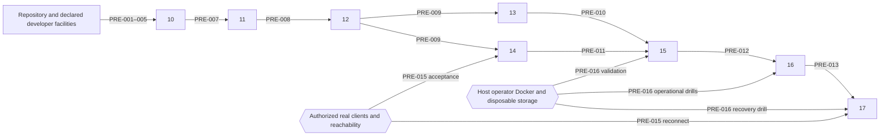

# Milestone Prerequisite Manifest

- Packet: `delivery/milestones/secretsauce-mcp/status.yaml`
- Product ID: `secretsauce-mcp`
- Audited revision: final packet content digest in `workflow/delivery-planning/results/readiness.yaml`; compiler input `sha256:be71b3924591bc444b5da8b31ef0982f9e5e207024683c4c74806d2e13b8fe0d`.
- Source transaction: `06dd0ee59defd1a75db121f1d8133c7100238b80`; definition provenance closeout `bb6f29cd318b77c2cf70efa5b1f9adaf25fdf2cb`.
- Planning transaction: pending parent finalization; canonical commit is `workflow/delivery-planning/handoff.yaml` transaction.repository_commit. No child commit.
- Intended order: `10 → 11 → 12 → {13,14} → 15 → 16 → 17`.
- Order evidence: packet `status.yaml` dependencies and `index.md` Milestones and dependency contracts.
- Last audit: `2026-10-10T02:04:36+00:00`.

Current readiness concerns providers and execution facilities, not implementation completion. All eight milestones remain pending. A future provider is not described as already satisfied. Common developer inputs are explicit: supported Node/npm, locked package retrieval via registry or populated cache, writable working/temp directories, loopback permission and a local browser. No undeclared global frontend/database/service is assumed.

| ID | Description | Consumers | Classification | Current status | Proposed provider | Class | Verification | Commands executed | Files changed | Blocking | Evidence |
| --- | --- | --- | --- | --- | --- | --- | --- | --- | --- | --- | --- |
| PRE-001 | Committed definition, approved UX and unchanged historical gateway authority | 10–17 | Already satisfied | Verified source package/manifest revisions; no product decisions pending | Repository definition package and compiled_from | AUTO | Inspect exact source revisions and producer history; inspect approved UX manifest | Compiler source checks consumed; Git HEAD/status inspected | None | Yes, before starting | FACT: status.yaml compiled_from; workflow/definition/definition-package.yaml |
| PRE-002 | Existing source, fixture catalogs, build/test scripts and CI baseline | 10–17 | Already satisfied | Verified 33 test files / 372 tests and build in isolated install | Repository package.json, lockfile, src, test, .github/workflows/ci.yml | AUTO | npm run build; npm test | Passed; initial sandbox listener failure resolved by unchanged permitted rerun | None | Yes, before validating | FACT: package.json scripts; CI quality-gates; test/gateway.test.ts self-signed fixtures |
| PRE-003 | Node >=22, npm, package retrieval and writable checkout/temp storage | 10–17 | Already satisfied | Host Node26.11.1/npm12.2.0; isolated cached installation verified; CI pins Node22 | Declared developer runtime plus locked npm packages | AUTO | node --version; npm --version; npm ci on clean checkout with registry/cache access | Versions; isolated npm ci --offline --no-audit --no-fund succeeded | None | Yes, before starting | FACT: package.json engines; Dockerfile Node22; CI setup-node22. Cold-network retrieval not exercised |
| PRE-004 | Loopback listener permission and disposable filesystem for tests | 10–17 | Already satisfied | Available through approved narrow network execution; restricted default denies bind | Execution runner / existing synthetic test facilities | AUTO | npm test with loopback permission; no public bind required | Sandbox EPERM; identical npm test with loopback permission passed372 | None | Yes, before validating | FACT: AGENTS.md loopback rule; test/server.test.ts and test/gateway.test.ts |
| PRE-005 | Browser available for rendered, keyboard and narrow-width evidence | 10–17 | Already satisfied | Chrome154 installed; approved concept rendered earlier; no product browser acceptance yet | Developer browser; clean runner must explicitly provide browser | AUTO | Check installed browser version; render implemented local page and verify keyboard/320px when available | /opt/google/chrome/chrome --version; prior UX inspection consumed | None | Yes, before UI validation | FACT: installed Chrome; workflow/definition/drafts/product-ux/web-console-initial/index.md Visual inspection |
| PRE-006 | Reproducible console build/browser harness, durable-store setup and synthetic auth/fault fixtures | 10 | Owned by the consuming milestone | Not implemented; explicit first outcome scope | 10 secure setup vertical outcome | AUTO | Inspect 10 implementation plan for declared dependencies, lockfile, fixture-only storage/keys, browser commands and safe teardown; execute at acceptance | Not run: future implementation | None | Yes, before 10 acceptance, not before 10 implementation | FACT: 10 Scope/Architecture/Required Validation; no mandated external DB, framework or paid tooling |
| PRE-007 | Durable enrolled identity, current RBAC/audit admission, proof/session and operation status contracts | 11–17 | Provided by an earlier milestone | Pending provider10; baseline fail-open audit is intentionally replaced there | 10 | AUTO | Inspect completed10 status, slice commits and acceptance evidence before11; recheck transitive consumers | Not run: future implementation | None | Yes, at each consuming start | FACT: 10 outcome; 11 Preconditions; downstream audit constraints |
| PRE-008 | Shared drafts/apply/runtime publication, write-only credentials, service assignment/lifecycle | 12–17 | Provided by an earlier milestone | Pending provider11 | 11 | AUTO | Inspect completed11 status and atomicity/current-admission evidence before12 | Not run: future implementation | None | Yes, at each consuming start | FACT: 11 Interfaces; 12–17 Preconditions |
| PRE-009 | Four-role lifecycle/recovery, external issuer-subject registry and optional notification boundary | 13–17 | Provided by an earlier milestone | Pending provider12 | 12 | AUTO | Inspect completed12 status and identity-registry/recovery/notification evidence | Not run: future implementation | None | Yes, at each consuming start | FACT: 12 registry Functional Requirements; 13/14 both explicitly consume12 |
| PRE-010 | Complete advanced settings, explicit migration, sanitized history and export | 15–17 | Provided by an earlier milestone | Pending provider13 | 13 | AUTO | Inspect completed13 status and field-round-trip/history validation | Not run: future implementation | None | Yes, before15 | FACT: 13 outcome; 15 Preconditions |
| PRE-011 | Per-user MCP grants, current auth modes and client/restart integration | 15–17 | Provided by an earlier milestone | Pending provider14 including live-client evidence | 14 | AUTO | Inspect completed14 status and client evidence satisfying PRE-015 | Not run: future implementation | None | Yes, before15 | FACT: 14 acceptance; 15 Preconditions |
| PRE-012 | All persisted product domains, limits, audit provenance views and persistent deployment runbook | 16–17 | Provided by an earlier milestone | Pending provider15 including Docker evidence | 15 | AUTO | Inspect completed15 status, operating-envelope and deployment evidence | Not run: future implementation | None | Yes, before16 | FACT: 15 outcome; 16/17 Preconditions |
| PRE-013 | Portable encrypted archives, independent recovery material, manifest and job gate | 17 | Provided by an earlier milestone | Pending provider16; synthetic key material generated during implementation | 16 | AUTO | Inspect completed16 status and independently decrypted archive fixture with exclusion checks | Not run: future implementation | None | Yes, before17 | FACT: 16 Interfaces/acceptance; 17 Preconditions |
| PRE-014 | New fixtures, bounded parsers, fault/clock/load/storage harnesses and operational validation for each outcome | 11–17 | Owned by the consuming milestone | Future implementation; existing local HTTP/HTTPS fixtures are reusable | Each consuming milestone; earlier shared harness from10 | AUTO | Inspect owning Required Validation and implement declared fixture commands; synthetic credentials only | Not run: future implementation | None | Yes, before owning acceptance | FACT: each contract Required Validation; test/auth.test.ts temp key/state fixtures; no real downstream service required |
| PRE-015 | Authorized real ChatGPT and Codex test access with reachable isolated MCP endpoint | 14,17 | Requires user action | Unverified; no account authorization or external reachability assumed | Product Owner / authorized interoperability tester | USER_ACTION | Instructions below; dated real-client flow results for both clients | Not run: no account sign-in or endpoint provisioning authorized here | None | Yes at14 acceptance, repeated17; no block on10 | FACT: 14 acceptance explicitly real clients; 17 required reconnect evidence |
| PRE-016 | Permitted Docker daemon, isolated proxy/storage deployment and disposable recovery target | 15–17 | Requires user action | CLI29.9.0/Compose5.6.0 present; daemon denied in current sandbox; usable test host unverified | Host operator / CI maintainer | USER_ACTION | Instructions below; daemon/version evidence then milestone smoke/restart and isolated restore records | docker version denied daemon socket; docker compose version passed | None | Yes at15 Docker validation and16/17 operational drills; no block on10 | FACT: 15 Docker smoke acceptance; 16 mounted backups; 17 clean-host drill |
| PRE-017 | Optional SMTP delivery exercised safely without real recipients/provider setup | 12,16 | Owned by the consuming milestone | Local stub/manual-link path allowed; production SMTP is optional | 12 notification fixtures;16 backup-alert fixtures | AUTO | Verify bounded synthetic delivery success/failure and manual fallback; no live mail required | Not run: future implementation | None | Yes for feature evidence; external SMTP non-blocking | FACT:12 Known Risks and functional manual fallback;16 notification tests |
| PRE-018 | Protected synthetic archive/keys, separate empty storage and failure-injection fixtures for recovery | 16,17 | Owned by the consuming milestone | Generated from completed providers in disposable directories; not production data | 16 archive fixtures and17 recovery fixtures; PRE-016 operator test host for deployment drill | AUTO | Verify independence from original state/key, rollback isolation and fresh enrollment with synthetic data | Not run: future implementation | None | Yes before recovery acceptance | FACT:16 clean isolated decryption;17 validation and conditional RTO. Replacement production infrastructure is outside drill scope |

## External completion instructions

**PRE-015 — Product Owner / authorized interoperability tester; first consuming boundary: milestone14 acceptance, repeated at17 after restore.** Before that boundary, confirm access to both clients capable of custom MCP connections and provide an authorized isolated test endpoint reachable from those clients. Use synthetic services/accounts and HTTPS reachable from ChatGPT; keep management exposure constrained as designed. The operator owns any account registration, authentication, DNS/certificate/firewall or existing test-infrastructure changes. Do not publish a private instance automatically or send raw client secrets in workflow evidence. Record tester authorization, client/version/date, successful consent/discovery/reference/request/denial/revoke/restart/reconnect for both clients with safe screenshots/results under `evidence/platform/`. Re-run fresh authorization/reconnect after restore in17. No mocks substitute for these records. Milestone14 may develop protocol behavior beforehand but cannot complete without this evidence;15 cannot start before14 completes.

**PRE-016 — Host operator / CI maintainer; first consuming boundary: milestone15 Docker/proxy validation, continued16/17.** Supply an already authorized disposable Docker-capable host or CI job with permitted daemon access, image/package retrieval, writable independent app/audit/backup mounts and sufficient temporary staging/rollback storage for the declared synthetic fixture. Verify `docker version` reports client and server successfully and `docker compose version` succeeds. Then, using the implemented milestone15 deployment instructions, record one-instance build/start/health/restart, persisted state/audit/signing behavior and ephemeral references. Before16/17 drills, record separate disposable empty target storage, archive plus independently held synthetic recovery material, fault-injection cleanup procedure and disk-capacity check for the actual fixture. Record snapshot/decryption and clean-host/failed-install/reconnect timing evidence under `evidence/platform/`. Do not change Docker group membership, install OS packages, start persistent services or alter real deployment state during readiness. Current socket denial proves this sandbox lacks access, not that Docker is absent or globally broken. Existing CI defines Docker builds; actual updated runtime smoke/drill execution is still unverified.

## Developer and milestone-owned facilities

**PRE-003/004:** The isolated installation used the committed lockfile and local npm cache, not the original node_modules. It is not a cold-network Node22 environment test. Current Node26 satisfies the declared >=22 range; CI/Docker still specify22. A future clean runner executes `npm ci`, `npm run build`, `npm test` with its declared Node22 CI baseline. Network/cache failure is an environment prerequisite to resolve then, not evidence that packages are missing now. npm12 warned that esbuild postinstall was blocked by its allowScripts policy; no approval/config was changed, and build/test worked with locked platform packages. If a chosen future dependency requires build scripts, make the need explicit within its consuming implementation plan.

**PRE-005/006:** Installed browser existence/version and earlier concept rendering establish a usable current facility, not console UX acceptance. An isolated prior browser cache and undeclared Playwright/React/database packages in the original node_modules are not clean-environment providers. Milestone10 must declare and lock its actual console/test dependencies and reproducible browser commands or documented manual procedure as part of its vertical outcome. Browser/OS installation, if needed on a different runner, is operator-owned; pause that runner until available. No particular framework/database/browser library is required by this packet.

**PRE-014/017/018:** Fixture generation, in-process mock SMTP/HTTP services, disposable key/identity stores, workload/fault clocks and archive corruption fixtures belong to the outcome they prove. No real service credential, external SMTP account, production data, remote backup integration or new shared infrastructure is needed for these cases. The full self-signed HTTPS gateway tests already carry their certificate fixture; OpenSSL is not a newly imposed runtime prerequisite.

## Dependency graph

Repository/environment provides PRE-001–005 to every milestone. Milestone10 owns PRE-006. Each consumer owns PRE-014 where listed;12/16 own PRE-017;16/17 own PRE-018. The graph below shows every cross-milestone provider plus explicit external gates. Edges to the earliest dependent carry the same prerequisite transitively to all consumers listed above.

No unresolved provider, forward provider or cycle was found. External setup does not depend on a later product milestone; concrete product smoke/drill evidence waits for the owning implementation. M13 and M14 share the already-provided registry from12 and need no dependency on each other. Combined import/client integration is checked after both at15.
