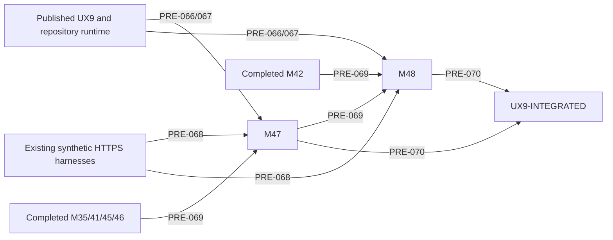

# UX9 milestone readiness report

## 1. Overall readiness status
**READY** — M47/48 have a valid dependency order and supported local prerequisites; M48 starts only after M47 acceptance. Parent planning publication remains pending.

## 2. Scope and evidence basis
Read both new contracts, source/compiler, index, graph and relevant bootstrap/test sources. Compared all 37 completed records/contracts and previous goal/regression checkpoints against planning start `985b8d0`: unchanged. Exact current fingerprints are in the result. This is prerequisite readiness, not implementation acceptance.

## 3. Automatically completed prerequisites
Verified PRE-066–069 and added checks to M47/48. No installs, product changes, running services or child commits.

## 4. Confirmation-gated work
None.

## 5. Required user actions
None for the local scope.

## 6. Missing or unresolved prerequisites
None. PRE-070 is deliberate implementation-owned qualification; M47 is a declared earlier provider for M48.

## 7. Dependency graph

All 39-node dependency edges point to existing earlier providers; no cycle or hidden reverse dependency.

## 8. Proposed milestone order
Preserve declared M47 then M48; no reordering.

## 9. Milestone 0
Not required. Existing repository setup and fixtures supply shared foundations.

## 10. Per-milestone readiness
M47 ready to start after parent planning publication and delivery authorization. M48 ready in the declared sequence, contingent on M47 completion. Both carry PRE-066–070 checks and preserve targeted role/audit/stale/uncertain/compatibility/browser obligations. Full regression is due at UX9-INTEGRATED, not before every slice. No required acceptance obligation was removed.

## 11. Clean-environment simulation
PASS, conceptual INFERENCE from declared sources, not an installation test. Clean checkout → Node >=22/OpenSSL → `npm ci` → declared Chromium (`npx playwright install chromium`, writable PLAYWRIGHT_BROWSERS_PATH) or pinned Playwright1.64 Docker image → build → disposable synthetic HTTPS fixtures → focused M47 acceptance → M48 acceptance → final frozen-source full suite/build and joined qualification. No current dist, live configuration, real credential or undeclared cache required. Fresh package/browser downloads need ordinary provisioning network. Final suite uses bounded workers and no concurrent browser/Docker work; loopback EPERM is retried with permission, never weakened assertions. Prior tracked-source export technique excludes unrelated local session artifacts without reading/moving them. Changed transport/recovery boundaries retain their conditional checks.

## 12. Commands run and results
- `node --version`: v26.12.1; `npm --version`:12.2.1; `openssl version`:3.6.5. PASS.
- `npm ls --depth=0`: PASS, declared dependencies resolve including Playwright1.64.
- Python graph/hash/path/preservation validation: PASS39 records,37 completed records/contracts and prior goal/checkpoints unchanged; source package digest matches compiler; named tests/harnesses exist.
- `git diff --check`: PASS at handoff.
- Existing browser facility inspected from harnesses and retained UX8 qualification. No Docker/browser run, build, full test suite or feature acceptance during readiness.

## 13. Files changed
Readiness checks only in M47 and M48; `prerequisite-manifest.md`; this report; `workflow/delivery-planning/results/readiness.yaml`. Parent/compiler owns all other pending changes. Completed contracts and status records untouched by readiness.

## 14. Remaining blockers
None. Parent publication pending as transaction boundary, not a semantic blocker.

## 15. Exact recommended next step
In `/home/ha/projects/secretsauce`, Delivery Planning validates and publishes its combined transaction, then hands `delivery/milestones/secretsauce-mcp/status.yaml` to milestone delivery starting M47 when authorized. READY does not certify features or deployment.
