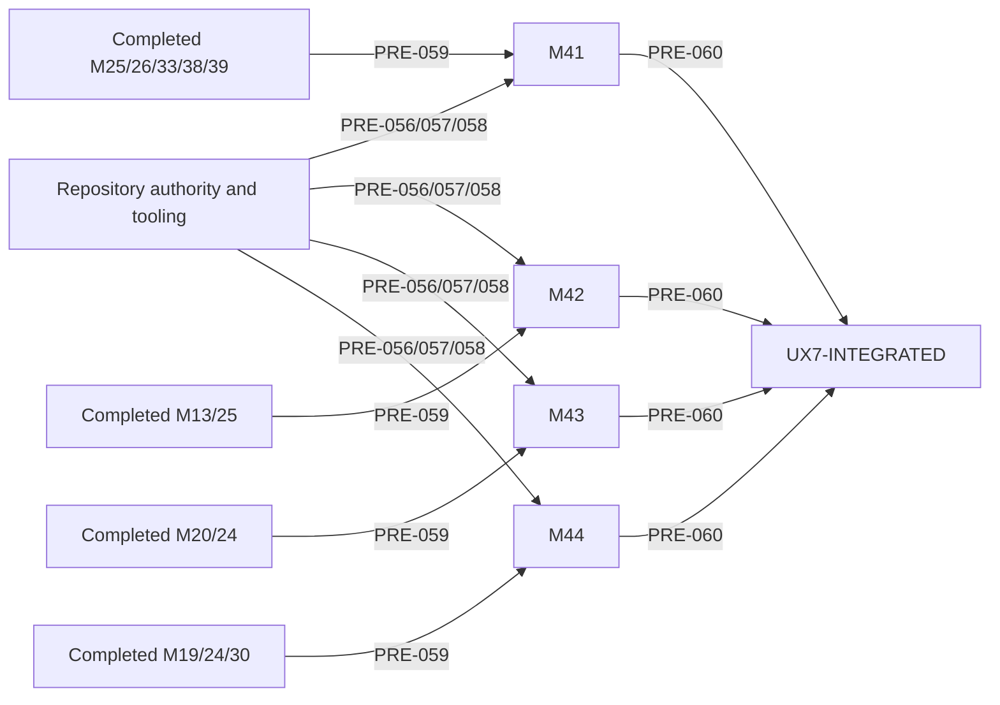

# Readiness report — UX7 consistency packet

## 1. Overall readiness status

**READY** — M41–44 have verified completed providers, declared local validation facilities and an executable clean-checkout path. Parent publication must close before implementation handoff; this is not feature acceptance.

## 2. Scope and evidence basis

Active packet `delivery/milestones/secretsauce-mcp/status.yaml`; new M41–44 contracts, index, traceability, compiler result and regression checkpoint inspected. Complete 35-node dependency graph audited; completed 31 contracts/records and delivery goal/history compared unchanged to planning start `6e3d03668eb061a27aca488dfa6eb96b60508a20`. Relevant setup evidence: package/lock, CI Node22, Dockerfile, documented Chromium setup, named tests and synthetic HTTPS harnesses, current UX audit reproduction. Current UX7 package is primary PRODUCT_BUILD authority; REC012's historical revalidation flag is discharged by the committed definition handoff. All 12 remediation mappings and 53 feedback dispositions remain covered. Exact packet hashes are in the result adapter.

## 3. Automatically completed prerequisites

PRE-056–059 verified with metadata/hash/path inspections and lightweight capability probes. Added PRE-056–060 references and concrete readiness checks to M41–44. No installation, product change, service start, feature test, build or child commit.

## 4. Confirmation-gated work

None. Docker image inspection required a narrow authorized read after the sandbox denied socket access; it succeeded and started no container. No prerequisite remediation needing confirmation was performed.

## 5. Required user actions

None for current local execution. Existing browser-testing authorization and disposable fixtures suffice. No real secrets, SMTP account, DNS, OAuth registration or live deployment is required.

## 6. Missing or unresolved prerequisites

None. Implementation-specific assertions, screenshot comparisons and integrated regression belong to PRE-060, not bootstrap. Audit uninspected states remain validation obligations, not falsely certified conformance.

## 7. Dependency graph

No missing provider, reverse edge, cycle or undeclared cross-milestone prerequisite. Shared editing files require integration care but do not manufacture a new behavioral dependency.

## 8. Proposed milestone order

Preserve M41, M42, M43, M44 recommendation. Each is eligible after its completed providers; M41 gives the earliest integrated import/correct/review demonstration. No reordering.

## 9. Milestone 0

**Not required.** Existing runtime, storage, setup, package/CI and browser fixtures already supply shared foundations.

## 10. Per-milestone readiness

| Milestone | Providers | Readiness checks / result | Blockers |
|---|---|---|---|
| M41 | PRE-056–059, completed25/26/33/38/39 | Source hashes, precise-service test and navigation/approval harness paths, provider graph verified | None |
| M42 | PRE-056–059, completed13/25 | Migration/history/advanced tests and advanced browser harness paths verified; second synthetic instance is fixture-owned | None |
| M43 | PRE-056–059, completed20/24 | Settings/operations/backups/auth tests and populated/focused/operations harness paths verified; approved desktop/narrow references exist | None |
| M44 | PRE-056–059, completed19/24/30 | Notifications/SMTP deletion/modes/settings tests and SMTP harness paths verified; synthetic SMTP needs no external server | None |

Every new contract now includes explicit prerequisite IDs and supported commands. PRE-060 remains owned at each acceptance boundary; the full `npm test -- --maxWorkers=2` and build/combined browser matrix run once at UX7-INTEGRATED before deployment/final packet acceptance, with no simultaneous browser/Docker work during full regression. Existing regression escalation and conditional transport/recovery checks remain mandatory.

## 11. Clean-environment simulation

**PASS, conceptual**: clean checkout supplies all completed provider source; install declared Node22-compatible runtime and OpenSSL, run `npm ci`, then milestone build when validating. Provision matching Chromium via `npx playwright install chromium` and declared `PLAYWRIGHT_BROWSERS_PATH`, or the pinned Playwright1.64.0-noble Docker route from current audit reproduction. No undeclared cache, prior `dist`, credential, running instance or database is assumed. Browser fixture creates synthetic HTTPS and isolated temporary stores. Each M41–44 consumes completed repository providers, then supplies its own new tests/evidence; after all four, run the integrated checkpoint. Fresh installation was simulated rather than repeated; current-machine probes and retained matching-version browser evidence establish feasibility, not feature correctness.

## 12. Commands run and results

- Git status/HEAD and Python metadata/hash/dependency checks: PASS, unrelated paths untouched; graph35, completed31 preserved, required12 remediations/53 feedback mapped; source/package and current UX artifact/concept hashes match.
- `node --version`, `npm --version`, `openssl version`, `docker --version`: v26.12.1,12.2.1,3.6.5,29.9.2.
- `npm ls --depth=0`: PASS declared dependencies, including @playwright/test1.64.0 and Vitest3.2.6.
- `docker image inspect mcr.microsoft.com/playwright:v1.64.0-noble --format '{{.Id}}'`: initial sandbox socket denial, then authorized read-only PASS; image `sha256:06a9939e57531807f8d5fd76ce44b53165ffb7d7501d87ab10e285c20b1e971f`.
- Structural milestone validator with completed status allowed: PASS35 records/contracts, before and after readiness additions.
- `git diff --check`: PASS.
- Initial exploratory reads used a nonexistent docs/development glob/supporting path and assumed all historic records had evidence keys; corrected to canonical docs/console-operations.md, supporting-evidence and commit/evidence metadata. No finding or mutation resulted.
- Full suite, build, browser reruns and installs: not run; no bootstrap gap justified acceptance workloads.

## 13. Files changed

M41–44 Markdown readiness sections only; `delivery/readiness/secretsauce-mcp/prerequisite-manifest.md`; this report; `workflow/delivery-planning/results/readiness.yaml`. Compiler-owned status/index/traceability and all completed contracts remain untouched by readiness. Parent owns publication.

## 14. Remaining blockers

None. Parent commit/provenance closeout remains a publication obligation, not an unresolved semantic or environment prerequisite.

## 15. Exact recommended next step

Delivery Planning should validate and commit the combined compiler/readiness transaction, then hand off `delivery/milestones/secretsauce-mcp/status.yaml` starting at M41 to milestone-delivery-orchestrator in `/home/ha/projects/secretsauce` when authorized. Do not infer deployment permission or feature acceptance from READY.
